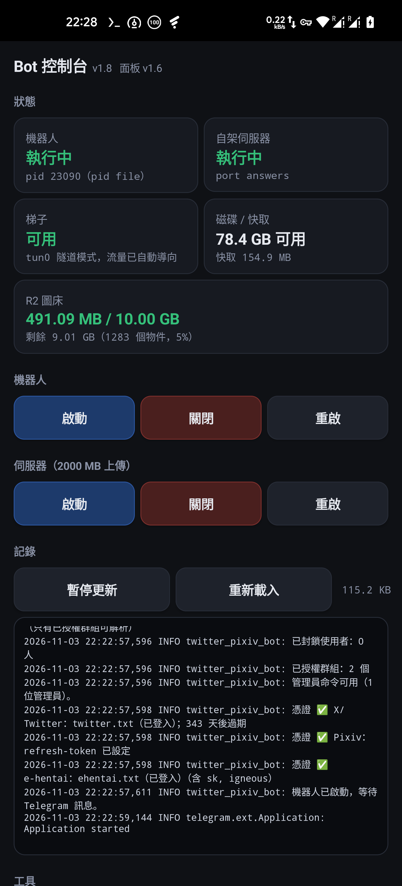

# twitter_pixiv_tg_bot — Android

把 X/Twitter、Pixiv 與 e-hentai 的連結變成可直接瀏覽的媒體，跑在**你的手機**上。

在 Telegram 傳一個連結給它，它回傳檔案；e-hentai 的畫廊會被整理成一頁可以滑的
Telegraph 頁面，圖片託管在 Cloudflare R2，所以那些簽章網址過期之後頁面也不會壞掉。

**在已 root 的 OnePlus 8 Pro（Pixel Experience 13，AOSP 13，aarch64）上開發**，
但程式碼本身沒有任何一處綁定這台裝置 —— 探測腳本會告訴你另一台手機能不能跑。

---

## 目錄

**開始使用**
- [這是什麼](#這是什麼)
- [功能](#功能)
- [管理員確認傳送到頻道](#管理員確認傳送-xtwitter-結果到頻道)
- [本機檔案製作 Telegraph](#本機檔案製作-telegraph)
- [快速開始](#快速開始)
- [手機 App](#手機-app)
- [控制面板](#控制面板)

**設定與原理**
- [設定參考](#設定參考)
- [快取策略](#快取策略)
- [R2 圖床與免費額度](#r2-圖床與免費額度)
- [標籤翻譯](#標籤翻譯)
- [代理與網路](#代理與網路)

**深入**
- [2000 MB 上傳上限](#2000-mb-上傳上限)
- [e-hentai 解析流程](#e-hentai-解析流程)
- [Android 特有的問題](#android-特有的問題)

**疑難排解與維護**
- [疑難排解](#疑難排解)
- [套件漏洞檢查](#套件漏洞檢查)
- [更新標籤字典](#更新標籤字典)
- [版本與發佈](#版本與發佈)
- [編輯 PowerShell 腳本](#編輯-powershell-腳本)

**其他**
- [致謝](#致謝)
- [授權](#授權)

---

## 這是什麼

| 你傳的連結 | 得到什麼 |
| --- | --- |
| `x.com/.../status/...` | 圖片／影片原檔，多張自動組成相簿 |
| `pixiv.net/artworks/...` | 原圖（非壓縮），多張自動組成相簿 |
| `e-hentai.org/g/...` | **四個按鈕**：瀏覽頁（Telegraph）、歸檔（縮圖版／原圖版）|

Pixiv 原圖檔名使用 `作品名稱_作品ID_p頁碼_畫師ID_畫師暱稱.副檔名`，例如：

```text
夏日作品_150653396_p0_123456_畫師暱稱.jpg
夏日作品_150653396_p1_123456_畫師暱稱.jpg
```

頁碼從 `p0` 開始，快取重送也保留相同檔名。舊版快取會在下次解析時重新下載一次以取得命名資料。
檔名不能使用的字元會替換為 `_`；標題或暱稱過長時會縮短，並保留作品 ID、頁碼、畫師 ID 與副檔名。
改用 ZIP 傳送時，壓縮檔以第一張收錄圖片命名，裡面的每張原檔仍保留各自的頁碼。
依 Pixiv 來源網址強制使用 Telegram 的文件傳送方式，避免呼叫端分類影響結果。靜態圖片、GIF 與影片一律以文件傳送，包含新解析與快取重送，並關閉自動媒體類型偵測。Pixiv Ugoira 動圖若下載為影格 ZIP，會依原始順序與播放時間自動合成 GIF，然後直接以 `.gif` 文件傳送，保留原始解析度及全部影格，不縮圖、不刪幀、不合併相同影格。GIF 每幀最多 256 色，播放時間以格式支援的 10 毫秒為單位；這是 GIF 格式本身的限制。檔名使用相同格式，並支援快取重送；舊版 ZIP 快取會重新下載並轉換。GIF 文件若因過大被拒絕，會回報失敗，不額外壓縮或包成 ZIP。

**e-hentai 的四個按鈕：**

| 按鈕 | 做什麼 | 大小 |
| --- | --- | --- |
| **瀏覽（Telegraph）** | 建立可直接在 Telegram 內開的頁面，圖片託管在 R2 | 小 |
| **歸檔 · 縮圖版** | 下載 e-hentai 官方的 1280 版 ZIP | 中 |
| **歸檔 · 原圖版** | 下載官方的原圖 ZIP | 大 |
| **重新生成** | 修復已失效的頁面（原連結不變） | 小 |

**不支援的連結一律靜默** —— 不回覆、不報錯，群組裡也不會因為有人貼了別的網站而洗版。

---

## 功能

**解析**

- 三個站台的連結，含短網址與 `?p=N` 分頁變體
- 相簿自動分組（每組最多 10 張，超過自動拆成多則）
- 圖片超過 10 MB 會**降尺寸重編碼**，而不是拒絕傳送
- 檔案超過上傳上限時自動切分成多個 ZIP

**e-hentai**

- Telegraph 頁面，圖片在 R2，**網址不會因為 keystamp 過期而失效**
- 官方歸檔優先（比自行打包快得多，也準確得多）
- 標籤翻譯成繁體中文（台灣），14,324 條
- **自動偵測並修復失效的頁面**，原連結保持不變
- 同一本再送一次會**沿用既有的頁面**，不會產生第二個

**可靠度**

- 開機自動啟動，並**等到網路真的通了才開始輪詢**（見[代理與網路](#代理與網路)）
- 單一實例鎖，重複啟動不會產生兩個機器人
- 停止按鈕在**掃描與 R2 上傳階段都能真的停下**
- 解析快取分層：便宜的事每次重做，昂貴的事才複用（見[快取策略](#快取策略)）

**安全**

- 管理員指令有獨立的白名單
- 群組守門模式：只有授權的群組能用
- `/audit` 對每一個套件查 OSV 漏洞資料庫
- 控制面板只綁 loopback，需要時才產生 token

---

## 管理員確認傳送 X／Twitter 結果到頻道

1. 以 bot 管理員帳號將 bot 加入頻道，設為頻道管理員並開啟「發布訊息」權限，bot 會自動登記。
2. 在 bot 私聊傳送 X／Twitter 貼文連結。解析完成後，點「傳送到頻道」或「不傳送」。
3. **5 分鐘內未操作，預設不傳送**；逾時選項失效。多個頻道會各自顯示名稱，每次解析只選擇一個目標。

只有 bot 設定中的管理員會得到確認按鈕。一般使用者照常取得解析結果，不會看到頻道選項；群組、Pixiv、e-hentai 與本機檔案製作不會出現此選項。新解析與快取重送均支援。

管理員可在私聊輸入 `/channels` 查詢頻道；若 bot 已在頻道中、未收到加入事件，可使用
`/channels @頻道名稱` 或 `/channels -100頻道ID` 手動登記。私密頻道使用數字 ID。
`/channels remove -100頻道ID` 移除傳送選項。未登記頻道時不會自動發布。

確認後會複製該次私聊已送出的媒體及說明，保留相簿與來源連結，不重新下載、不複製處理提示。
發布前會重新檢查管理員與頻道發布權限；移除 bot 或撤銷發布權限後，頻道會從清單移除。
每次確認只能使用一次。傳送逾時或僅複製部分結果時會提示檢查頻道，不自動重送。
頻道清單保存在程式旁的 `channel_targets.json`，不提交 GitHub；確認選項不跨重啟保存，重啟後不會補發。

## 本機檔案製作 Telegraph

此功能**僅限私聊**，群組中的圖片與壓縮檔不會進入製作流程。

1. 在 bot 私聊傳送 ZIP／CBZ 或圖片文件，可累積多個檔案；此時只接收暫存，不上傳 R2。
2. 點「作者連結」或「E站連結」，依提示傳送完整網址；不提供可按「略過／移除連結」。
3. 按「上傳並製作」開始；多張圖片傳完也可輸入 `/publish`，將這批檔案合併為一份作品。
4. 不上傳可按「取消」；`/cancel_upload` 也可取消待製作或正在上傳的作品，頁面建立的最後階段請等待完成。

標題使用第一個收到的檔案名稱（去掉副檔名）；建議以作品名稱命名 ZIP／CBZ。
圖片按原始檔名自然排序，例如 `2.jpg` 會排在 `10.jpg` 前面；壓縮檔內以完整路徑排序。
Telegraph 內先放標題，再依序放圖片。完成訊息附上排序後第一張圖片作為封面，圖片說明包含「標題」及 `[ 即時預覽 ] / [ 作者 ] / [ E站 ]`，
「即時預覽」連到 Telegraph；「作者」「E站」使用本批使用者提供的連結，未提供的項目保留普通文字。

圖片產生長邊最多 **1280px** 的 JPEG 預覽副本，不放大小圖；透明背景轉白色，GIF 使用第一幀。
原檔保持不變，此流程也不影響 Pixiv 原圖／GIF 文件傳送。
需要沿用既有 R2 設定與可公開讀取的圖片網址；相同內容沿用 R2 物件，不重複上傳。
上傳失敗會提示並自動重試，連續三輪失敗後由發起者選擇再試或停止；停止後不建立頁面。
已成功的圖片不重傳。製作失敗可再次 `/publish`，或 `/cancel_upload` 清除暫存。

每批輸入合計最多 512 MiB、500 張圖片；單張最多 64 MiB／4000 萬像素，ZIP 圖片解壓總量最多 1 GiB。
不接受加密、重複檔名、不安全路徑或符號連結的壓縮檔。超過 Telegraph 頁面上限時會提示分批，不截斷圖片。
下載仍受使用中的 Telegram Bot API 限制；大檔案需使用本機 Bot API。
每份待製作資料依聊天及使用者隔離；閒置超過 24 小時會在接收新檔案時清除，重啟前請先發布。
一般 Telegram「照片」不含原始檔名，會以訊息編號命名；需要保留標題與排序時，請以**文件**或 ZIP／CBZ 傳送。
私聊同樣套用原有封鎖名單。作者與 E站連結只套用於本批作品，下一批需重新提供。

## 快速開始

### 需求

- Android 手機（arm64），**已 root** 才能用 2000 MB 上傳上限；不 root 也能跑，上限 50 MB
- Termux（[release 裡附 0.118.3](https://github.com/YuNaiAFK/twitter_pixiv_tg_bot_android/releases/latest)）
- 一個梯子 —— 開發時用 FlClash 的 **TUN 模式**
- Telegram 的 `api_id` / `api_hash`（<https://my.telegram.org>）

### 安裝

```bash
pkg install git
git clone https://github.com/YuNaiAFK/twitter_pixiv_tg_bot_android.git ~/twitter_pixiv_tg_bot
cd ~/twitter_pixiv_tg_bot
bash scripts/setup-termux.sh
```

這會裝好 Python 與相依套件、從範例建立 `.env`，然後**在 Debian chroot 裡建置自架的 Bot API 伺服器**。
建置是最慢的部分 —— **手機上 20 到 60 分鐘**，而且會編譯 TDLib，**請插著電源**。

不需要 2000 MB 上限的話：

```bash
bash scripts/setup-termux.sh --no-server
```

### 設定

編輯專案根目錄的 `.env`（完整清單見[設定參考](#設定參考)）：

```
BOT_TOKEN=<向 @BotFather 取得>
ADMIN_USER_IDS=<你的數字 id，在 bot 裡用 /id 取得>
```

要 2000 MB 上限再加上：

```
TELEGRAM_API_ID=<my.telegram.org>
TELEGRAM_API_HASH=<my.telegram.org>
TELEGRAM_API_BASE=http://127.0.0.1:8081
TELEGRAM_LOCAL=1
```

把登入憑證放進 `cookies/` —— `twitter.txt` 與 `ehentai.txt`，格式為 **Netscape cookie**。

> **刻意不使用 `gallery-dl --cookies-from-browser`。** Android 核心預設封鎖 `ptrace`，
> 讀取瀏覽器的 cookie 資料庫根本不可能運作。純 cookie 檔案是唯一可靠的方式。

Pixiv 用 refresh token，跑一次即可：

```bash
python bot/pixiv_login.py
```

### 執行

```bash
bash scripts/run-bot.sh                 # 前景，Ctrl-C 停止
bash scripts/run-bot.sh --background    # 關掉工作階段也不會停
bash scripts/run-bot.sh --status
bash scripts/run-bot.sh --stop

bash scripts/run-server.sh start|stop|restart|status|logs
```

**開機自動啟動：**

```bash
mkdir -p ~/.termux/boot
cp scripts/boot-services.sh ~/.termux/boot/10-bot.sh
chmod +x ~/.termux/boot/10-bot.sh
```

Termux:Boot 安裝後必須開啟一次，而且 **Termux 與梯子 App 都必須免除電池最佳化**，
否則 Android 會把它們殺掉。

---

## 手機 App

一個原生 App（`app/`），提供與控制面板相同的動作，**正常情況下 Termux 裡一個字都不用打。**



### 安裝 APK

需要的東西都附在[最新的 release](https://github.com/YuNaiAFK/twitter_pixiv_tg_bot_android/releases/latest)：

| 檔案 | 大小 | 是什麼 |
| --- | --- | --- |
| `bot-panel.apk` | 48.8 KB | 控制 App |
| `termux.apk` | 108.6 MB | Termux 本體（0.118.3，F-Droid 版）|
| `termux-api.apk` | 3.8 MB | 提供 `termux-wake-lock` |
| `termux-boot.apk` | 25.4 KB | 開機時啟動服務 |

```bash
adb install -r bot-panel.apk
adb install -r termux.apk
adb install -r termux-api.apk
adb install -r termux-boot.apk
```

**Termux 本體是 108.6 MB**，超過 GitHub 對單一檔案 100 MB 的上限，所以它放在 release 裡而不是
`apk/` 裡。**每個 release 都保留該版本的 `bot-panel.apk`**，新版本出問題時還是能取得舊的建置。

安裝程式做不到的兩件事，**兩件都必須完成**，App 才能啟動任何東西：

```bash
# 1. 讓 App 有權限送 intent 給 Termux
adb shell pm grant com.yunai.botpanel com.termux.permission.RUN_COMMAND

# 2. 讓 Termux 接受外部應用程式的 intent（然後 Termux 必須重新啟動）
bash ~/twitter_pixiv_tg_bot/scripts/enable-external-apps.sh
```

### 一鍵啟動

按下 **一鍵啟動服務** 會送出一個 `com.termux.RUN_COMMAND` intent，讓 Termux 執行
`scripts/start-all.sh` —— 與開機腳本用的是同一支。App 接著持續輪詢，直到面板回應、
卡片自己消失，**所以它也會偵測到你手動執行的指令**。

```bash
bash ~/twitter_pixiv_tg_bot/scripts/start-all.sh            # 全部，照順序
bash ~/twitter_pixiv_tg_bot/scripts/start-all.sh --status   # 只回報
bash ~/twitter_pixiv_tg_bot/scripts/start-all.sh --restart  # 先停，再起
```

### 全部關閉

**電源 → 全部關閉（含面板）** 會先停機器人、再停伺服器、最後停面板自己。

它被放在獨立的一區、遠離其他工具，因為那個畫面上的其他東西都能從那個畫面復原 ——
**而這一個結束了 App 自己的用處**，因為面板是最後消失的東西。

> **為什麼面板會先回應才死掉：** 請求是透過 HTTP 進來的，而面板本身就是被停止的東西之一。
> 在還處理著請求的時候把它殺掉，會在回應寫出之前就關掉 socket，App 就會對一個成功的動作
> 回報失敗 —— 那是最糟的一種回饋，因為它會誘使使用者再按一次。
>
> 所以工作被交給一個**分離**的行程（`start_new_session=True`），它等兩秒，而處理函式立刻回傳。
> 實測：回應在 13 毫秒內送達、讀到的時候伺服器已經消失、面板自己則在兩秒後結束。

**要回來不需要打任何字** —— 靠的就是「一鍵啟動服務」那張卡片，它**不需要面板活著**。

### 不用 Gradle 建置

Gradle 加上 Android Gradle Plugin 大約要下載 500 MB，第一次建置要好幾分鐘解析依賴。
這個 App 只有一個 activity、沒有任何函式庫依賴，所以 `build.ps1` 直接驅動 AGP 底下的工具鏈：
`aapt2`、`javac`、`d8`、`zipalign`、`apksigner`。**APK 只有 48.8 KB。**

```powershell
powershell -File app/build.ps1              # 建置
powershell -File app/build.ps1 -Install     # 也會推到裝置
powershell -File app/build.ps1 -Clean -Install
```

需要 541 MB 的 SDK：

```bash
sdkmanager "platform-tools" "platforms;android-34" "build-tools;34.0.0"
```

---

## 控制面板

一個本機網頁，用來啟動、停止、重啟機器人與伺服器，查看記錄、清除快取、編輯 `.env`。

```bash
bash control/run-panel.sh start      # 然後開啟 http://127.0.0.1:8090/
bash control/run-panel.sh status
bash control/run-panel.sh stop
```

在 Chrome 裡用**選單 → 加到主畫面**就會變成類應用程式圖示：manifest 設定了
`display: standalone`，所以它會全螢幕開啟、沒有網址列，而且因為所有東西都從手機內部提供，
**它可以離線運作**。

> **App 是透過面板跟 Termux 溝通的。** 啟動機器人意味著要在 Termux 裡跑 `run-bot.sh`，
> 而直接讀 Termux 的記錄不可能 —— `/data/data/com.termux/files/home` 對其他套件不可讀。
> 所以**面板沒在跑的時候，App 什麼都不能做**，它會顯示一個橫幅、寫出啟動用的指令，
> 而不是一個看起來壞掉的空白畫面。

**每一個按鈕都是去呼叫 `run-bot.sh` 或 `run-server.sh`。** 面板不重新實作啟動機器人，
所以它不可能跟那些腳本的行為脫節 —— 而且面板能做的事，在面板沒跑的時候用命令列一樣能做完。

**只綁定 `127.0.0.1`。** 面板可以讀寫 `.env`（裡面有 bot token），也可以啟動與停止機器人 ——
在沒有密碼的情況下從區網可達，那就等於一個遠端 shell。要對外開放必須明講：

```bash
PANEL_HOST=0.0.0.0 bash control/run-panel.sh start     # 會印出 token，每個請求都必須提供
```

**面板不在開機腳本裡。** 沒有理由地讓一個 HTTP 服務一直跑著，是一種不值得養成的習慣。

---

## 設定參考

所有設定都在專案根目錄的 `.env`。`.env` **先讀專案根目錄**，再讀 `bot/`，
所以只要編輯最上層那一個檔案。

### 必要

| 鍵 | 說明 |
| --- | --- |
| `BOT_TOKEN` | 向 [@BotFather](https://t.me/BotFather) 取得 |
| `ADMIN_USER_IDS` | 數字 id，用逗號分隔。在 bot 裡打 `/id` 取得 |
| `BLOCKED_USER_IDS` | 封鎖名單（私訊黑名單模式）|

### 上傳

| 鍵 | 預設 | 說明 |
| --- | --- | --- |
| `MAX_UPLOAD_MB` | `45` | 單檔上限。不用伺服器時保持在 50 以下 |
| `MAX_FILES` | `20` | 單次解析最多幾個檔案 |
| `MAX_DOWNLOAD_SECONDS` | `180` | 下載逾時 |
| `MAX_CONCURRENT_DOWNLOADS` | `2` | 同時幾個解析 |
| `USER_COOLDOWN_SECONDS` | `10` | 每人兩次指令之間的最短間隔 |

### 快取

| 鍵 | 預設 | 說明 |
| --- | --- | --- |
| `CACHE_FILE` | `parse_cache.json` | 索引 |
| `CACHE_DIR` | `.cache` | 檔案（只有 Twitter／Pixiv 會用到）|
| `CACHE_STALE_SECONDS` | `1209600`（14 天）| 條目過期 |
| `CACHE_MAX_ENTRIES` | `300` | 條目上限 |
| `GALLERY_META_TTL_SECONDS` | **`0`** | **0 = 每次都重讀 tag／標題／評分** |
| `GALLERY_URL_TTL_SECONDS` | `7200`（2 小時）| 掃描到的圖片網址多久重用一次 |
| `GALLERY_CACHE` | `1` | 關掉會失去 Telegraph 頁面複用 |
| `ARCHIVE_CACHE` | `1` | 官方 ZIP 快取 |
| `ARCHIVE_CACHE_MAX_BYTES` | `8589934592`（8 GB）| 歸檔快取上限 |

### e-hentai

| 鍵 | 預設 | 說明 |
| --- | --- | --- |
| `EHENTAI_COOKIES` | `cookies/ehentai.txt` | Netscape 格式 |
| `TELEGRAPH_ALLOW_ADULT` | `1` | 成人畫廊要不要建立頁面 |
| `TELEGRAPH_AUTHOR` | `e-hentai 解析` | 頁面上顯示的作者 |
| `EHENTAI_VIEWER_WORKERS` | `6` | 掃描頁面時的並行數 |
| `EHENTAI_DOWNLOAD_WORKERS` | `6` | 下載頁面時的並行數 |
| `ARCHIVE_DEADLINE_SECONDS` | `300` | 官方歸檔的整體時限 |

### 圖床（選用）

五個值**必須全部填寫**，否則 R2 不啟用。詳見 [R2 圖床](#r2-圖床與免費額度)。

```bash
R2_ACCOUNT_ID=
R2_ACCESS_KEY=
R2_SECRET_KEY=
R2_BUCKET=
R2_PUBLIC_BASE=          # 例如 https://img.example.com
R2_FREE_BYTES=10000000000
R2_LIMIT_PERCENT=95
```

### 網路

| 鍵 | 預設 | 說明 |
| --- | --- | --- |
| `BOT_PROXY` | （未設）| **TUN 模式下不要設**，見[代理與網路](#代理與網路) |
| `TELEGRAM_API_BASE` | （未設）| 自架伺服器：`http://127.0.0.1:8081` |
| `TELEGRAM_LOCAL` | `0` | `1` = 把路徑交給 Telegram，連上傳時間都省掉 |
| `STARTUP_WAIT_SECONDS` | `900` | 開機時最多等網路多久 |

### 行為

| 鍵 | 預設 | 說明 |
| --- | --- | --- |
| `REPLY_UNSUPPORTED_LINKS` | `0` | `0` = 不支援的連結完全靜默 |
| `ATTACH_SOURCE_LINK` | `1` | 附上原始連結 |
| `DELETE_STATUS_MESSAGE` | `1` | 完成後刪除機器人送出的「正在解析……」提示；使用者原始訊息一律保留 |
| `AUTH_GROUP_LOCKED` | `0` | `1` = 只允許授權過的群組 |

---

## 快取策略

**這裡只有一件事值得記住：便宜的事每次重做，昂貴的事才複用。**

| 資料 | 成本 | 策略 |
| --- | --- | --- |
| 標題、tag、評分 | **1 個請求** | **每次都重讀**（`GALLERY_META_TTL_SECONDS=0`）|
| 掃描到的圖片網址 | **每頁 1 個，50 頁 = 50 個** | 2 小時（`GALLERY_URL_TTL_SECONDS`）|
| Telegraph 頁面網址 | 建立一個新頁面 | 永久，直到條目過期 |
| R2 圖片網址 | 每張重新計算雜湊 | 永久，直到條目過期 |
| Twitter／Pixiv 檔案 | 重新下載 | 14 天（`CACHE_STALE_SECONDS`）|
| 官方歸檔 ZIP | 幾十 MB 的下載 | 8 GB 上限內 |

> **這一層分開是有代價換來的。** 原本 `CACHE_STALE_SECONDS`（14 天）管整個 payload，
> 所以 e-hentai 上編輯過的 tag 要**兩週**才會出現。改成 6 小時的 metadata TTL 之後仍然不夠 ——
> log 顯示一本 47 分鐘前快取的本子（`命中畫廊快取（2853 秒前）`）照樣顯示舊標籤。
> **省下的是「一個請求」，而代價是一個錯誤的答案，那不是節省。**

**畫廊的頁面圖片從來不存到本機** —— 解析時每一張直接串流到 R2。
`.cache` 裡的檔案全部屬於 Twitter／Pixiv；e-hentai 只有官方歸檔會落在磁碟上。

---

## R2 圖床與免費額度

e-hentai 的內嵌圖片網址是用 `keystamp` 簽章的，**時效一過，整個頁面的圖片會一起失效** ——
這正是「重新生成」按鈕存在的理由。

**圖片會被複製到 Cloudflare R2**，那裡的物件沒有這種時效。頁面上的網址因此變成
`https://img.example.com/...`，不會再過期。

**上傳前會用 SHA-256 內容雜湊檢查重複檔案**。相同內容即使檔名、副檔名不同，也會沿用既有 R2 網址；
舊版帶副檔名的物件同樣會被辨識。同一批或不同畫廊同時出現相同圖片時，也會共用物件。
新物件使用 `galleries/ab/cd/<sha256>`，並以 [R2 條件式上傳](https://developers.cloudflare.com/r2/api/s3/api/#conditional-operations)
防止其他程序同時建立相同檔案。無法完成重複檔案檢查時，會交給自動重試流程處理。

**R2 免費額度是每月 10 GB 儲存空間**（對外流量免費、讀取在額度內免費），
所以儲存是唯一可能產生帳單的部分。一本畫廊的顯示圖約 **30 MB**，大約可以放三百本。

**上限設在額度的 95%（9.5 GB），而不是額度本身。** 儲存是按月、按物件存在的時間計費，
所以剛好用到 10 GB、一週後才刪掉，那個月仍然超額。

兩道檢查，因為它們回答不同的問題：

| 時機 | 檢查 | 為什麼 |
| --- | --- | --- |
| **下載任何東西之前** | 桶裡已經存了多少 | 已經滿了就**直接拒絕** —— 抓 30 MB 下來才決定不上傳是浪費 |
| **每張圖片上傳前** | 已存 + 這張是否超額 | 第一道無法知道要上傳多少 —— 那只有下載了才知道 |

**檢查在寫入之前執行** —— 已經上傳的就是已經計費的。

用量是**詢問桶本身**，不是本地計數器：本地計數在你第一次從 Cloudflare 儀表板刪東西時就會漂移。
讀不到用量或圖片上傳失敗時，機器人會自動重試；每次只重傳失敗的圖片。連續失敗 3 次後，
會詢問發起解析的使用者要停止本次 e-hentai 解析，或再重試 3 次。選擇停止後不會繼續建立 Telegraph 頁面；
15 分鐘未選擇時，也會停止本次解析。

額度用完時會通知管理員，因為達到上限是代替操作者做的決定，而結果是頁面少了一些圖片。

**App 與面板都會顯示目前用量** —— 已用／總量、剩餘、物件數，以及一條 80% 轉黃、達到上限轉紅的進度條。

---

## 標籤翻譯

e-hentai 的標籤會翻譯成繁體中文（台灣）：

```
語言: #漢語 #翻譯
原作: #絕區零
角色: #貓宮又奈 #哲_|_華茲
藝術家: #nito
女性: #貓女 #黑皮 #獸耳 #蘿莉
```

**14,324 條**，由 [`tools/build_tag_translations.py`](tools/build_tag_translations.py) 從
[EhTagTranslation/Database](https://github.com/EhTagTranslation/Database) 產生。
目前對應上游 commit `4f4ab9d`（2026-11-03）。

**兩個轉換都是必要的：**

1. **簡體轉繁體用 `s2twp` 而不是 `s2t`。** `s2t` 只映射字符，所以「打印机」會變成「打印機」而不是
   「印表機」—— **字符轉換不是翻譯。** `s2twp` 連詞彙一起轉，那才是台灣實際讀到的東西。
2. **圖示標記會被剝掉。** 名稱欄可能是 `贝合`，直接切分會把 img 標籤
   留在變成 hashtag 的字串中間。

**artist 與 group 刻意不收。** 那兩者有 30,000 條，而它們的「翻譯」是筆名的羅馬拼音 ——
`endou hiroto` 變成「遠藤弘土」，沒有人會那樣搜尋，而且比原本的字串更長。
其餘十個命名空間才是讀者真正受益於中文的部分。

**同一個名字在不同命名空間有不同意思** —— `angel` 是女性的「天使」也是角色的「安吉爾」。
機器人只用值查表，所以只能留一個，而留的應該是**通用的描述性標籤**，不是剛好同名的角色名。
因此最特定的（character）先解析、最通用的（female）最後 —— **最後寫入的勝出。**

**要更新字典見[更新標籤字典](#更新標籤字典)。**

---

## 代理與網路

### TUN 模式：不要設代理

如果你的梯子跑在 **VPN／TUN 模式**（FlClash、v2rayNG 都是），**讓 `BOT_PROXY` 保持未設**。
流量已經被重新導向，再設代理只會讓每個請求失敗在一個關閉的埠上。

> **這個錯誤看起來不像設定問題。** 實測：`tun0` 正常、直連 `api.telegram.org` 回 302、
> `e-hentai.org` 回 200 —— 而每一個下載都失敗在
> `ProxyError: Failed to establish a new connection: [Errno 111] Connection refused`，
> 因為 `BOT_PROXY` 還指著切換模式前那個代理埠。
>
> **一個設定好但死掉的代理，比沒有代理更糟** —— 沒有代理會成功，關閉的埠讓每個請求失敗。

`ehentai.proxy_url()` 現在會**先探測 loopback 代理**，埠沒開就回退成直連，
所以切換模式不會再弄壞一個能用的網路。遠端代理不探測 —— 那是刻意的選擇，
短暫變慢不等於不存在。

### 代理模式：要用 HTTP 格式

只有在梯子確實開了一個**監聽中的代理埠**時才需要設定：

```
BOT_PROXY=http://127.0.0.1:7890
```

**格式很重要，因為 `apt` 與 `pip` 都不能用 SOCKS**，而兩者回報錯誤的方式都會把責任推給別的東西：

```
$ apt-get update
Unsupported proxy configured: socks5://127.0.0.1:10808
E: The repository 'https://packages-cf.termux.dev/apt/termux-main stable Release'
   does not have a Release file.
```

那段訊息點名的是**儲存庫**，所以讀起來像是鏡像站壞了。但實際上**每一個 Termux 鏡像都在正常提供它的
Release 檔** —— 從同一網段的電腦驗證過，五個全部回 `200`、內容都是 13134 位元組 —— 而 `apt` 對每一個都失敗。
**那行 SOCKS 才是唯一的線索，而它在錯誤訊息的上面。**

| 檔案 | 格式 | 原因 |
| --- | --- | --- |
| `~/.proxy-url` | **HTTP** | `apt` 與 `pip` 需要，也是 `~/.bashrc` 讀的 |
| `apt.conf.d/95proxy` | **HTTP** | apt 讀這個檔案，**優先於**環境變數 |
| shell 裡的 `http_proxy` | HTTP | 讓每個子行程都拿到可用的格式 |

**如果 apt 又說找不到 Release 檔**，先檢查代理再檢查鏡像站：

```bash
cat $PREFIX/etc/apt/apt.conf.d/95proxy
cat ~/.proxy-url
```

兩者都必須是 `http://`。**只在終端機裡修正會被下一次執行覆蓋掉；那個檔案才是關鍵。**

---

## 2000 MB 上傳上限

Telegram 公開 API 的單次上傳上限是 **50 MB**。自架 Bot API 伺服器可以提高到 **2000 MB**，
而 `TELEGRAM_LOCAL=1` 讓機器人把**路徑**交給 Telegram 而不是上傳位元組 —— 連上傳時間都省掉了。

`MAX_UPLOAD_MB=45` 是預設值，正是為了讓機器人在兩種情況下都能運作：沒有伺服器時，
檔案維持在 50 MB 公開上限內，不會有任何東西失敗。有伺服器時再把它調高。

**所以這個上限完全是選用的** —— 不建置伺服器，機器人照樣運作。

### 需要什麼

透過 `proot-distro` 的 Debian chroot，加上從原始碼編譯的 `telegram-bot-api`。
TDLib 佔了大半：在 8 核心手機上用 `-j2` 大約 **40 分鐘**，另外 rootfs 與建置目錄約需 1.1 GB。
結果是一個 45 MB 的執行檔。

### 這個執行檔不能直接跑

```
$ .../containers/botapi/rootfs/usr/local/bin/telegram-bot-api
cannot execute: required file not found
```

它的解譯器是 `/lib/ld-linux-aarch64.so.1`，那是 Debian 的 glibc 載入器。Android 用的是
`/system/bin/linker64`。**訊息從來沒提到載入器，所以讀起來像是檔案不見了。** 它必須透過：

```
proot-distro login botapi -- /usr/local/bin/telegram-bot-api ...
```

`run-server.sh` 就是做這件事。它也會嘗試兩種 rootfs 佈局，因為 **proot-distro 5.x 把它搬走了** ——
從 `installed-rootfs/<name>` 移到 `containers/<name>/rootfs`。只檢查舊路徑的話，
會對一個明明存在的執行檔回報「binary missing」。

### loopback 是共用的

從 Termux 應用程式實測：在 chroot 裡啟動一個監聽 `0.0.0.0:8099` 的服務，Termux 可以連上它，
所以機器人從容器外面連 `127.0.0.1:8081` 不需要任何轉送。

> ### ⚠️ 不要透過 `su` 測試這件事
>
> 用 `su 10209` 啟動的行程會落在 SELinux 網域 `u:r:magisk:s0`，在那裡建立 socket 會失敗，
> 回報 `PermissionError` / `socket: Permission denied`。**每一個用這種方式跑的網路測試都會回報網路壞了。**
>
> 三次獨立的調查分別得出「VPN 被殺了」、「VPN 從 chroot 連不到」、「chroot 被網路隔離」的結論，
> 全都是因為這個原因，而且**三次都錯了**。網路檢查必須從 Termux 應用程式執行。

### 建置時的兩個陷阱

**`proot-distro` 不需要 root** —— 它在使用者空間行程裡用 ptrace 實作 chroot 與 mount。
`su` 在這裡反而有害，因為它會把行程移到一個讀不到 Termux 自己目錄的網域。

**`PKG_CONFIG_PATH` 必須清掉。** 留著的話，pkg-config 會回答 **Termux 的** OpenSSL，
然後 CMake 會記下 `-isystem /data/data/com.termux/files/usr/include`，建置就會用 Debian 的 gcc
去編譯 Android/bionic 的標頭檔 —— 結果在 `sqlite3.c` 裡失敗，錯誤訊息是 `memccpy` 與 `strcasecmp`，
**跟 sqlite 一點關係都沒有的檔案。**

---

## e-hentai 解析流程

```
使用者傳連結
   │
   ├─ 讀 metadata（1 個請求）        ← 每次都重讀，tag 才會是新的
   │
   └─ 回覆四個按鈕
        │
        ├─ 瀏覽（Telegraph）
        │    ├─ 掃描每一頁的圖片網址     ← 貴，快取 2 小時
        │    ├─ 上傳到 R2                ← 可停止
        │    └─ 建立／更新 Telegraph 頁面
        │
        ├─ 歸檔（縮圖／原圖）
        │    ├─ 向 e-hentai 要官方 ZIP 連結
        │    ├─ 下載（分段並行，可停止）   ← 快取 8 GB 內
        │    └─ 上傳到 Telegram
        │
        └─ 重新生成
             └─ 檢查頁面圖片是否還活著，壞掉就修，原連結不變
```

**「重新生成」保留原連結**，因為它的目的就是修復那個連結裡的圖片，
而不是產生一個新的東西讓使用者重新分享。

**同一本再送一次會沿用既有的頁面** —— 這就是 `GALLERY_CACHE` 存在的理由，
關掉它會讓第二次送出產生第二個頁面。

---

## Android 特有的問題

### CPU 休眠

這是手機版機器人「停止運作」最常見的原因 —— 行程還活著，但輪詢已經悄悄停了。
`run-bot.sh` 啟動時會向 Termux 取得喚醒鎖定，結束時釋放（包含當掉的情況）。
沒有安裝 `termux-api` 時它會**警告**，而不是假裝成功。

### 系統殺掉行程

Android 會積極回收記憶體。兩件事有幫助：

- 對 Termux 關閉電池最佳化（設定 → 應用程式 → Termux → 電池 → 不受限制）
- 用 `--background` 執行，這樣它不會綁在可能被關掉的終端機上

### 喚醒鎖定不會撐過重新開機

用 Termux:Boot，把 `bash ~/twitter_pixiv_tg_bot/scripts/boot-services.sh` 放進 `~/.termux/boot/`。

**而且開機時網路通常還沒好** —— 梯子需要幾秒到一分鐘。`boot-services.sh` 會等，
機器人本身也會用 `wait_for_telegram()` 確認 Telegram 真的連得上，**才宣告自己啟動**。
這修掉了一個真實的故障：開機時 VPN 還沒起來，機器人啟動後死於 `telegram.error.TimedOut`，
而 log 卻說「機器人已啟動」。

### 平台差異來自真實的失敗

所有平台相關的程式碼都集中在 `bot/platform_support.py`，以及核心裡八個有防護的點：

| 項目 | Windows | Android |
| --- | --- | --- |
| **代理** | 從 `HKCU\...\Internet Settings` 讀取 | **沒有登錄檔**；只讀環境變數 |
| **子行程的解譯器** | `sys._base_executable`，因為 venv 啟動器會多開一個主控台視窗 | `sys.executable` |
| **分離行程** | `DETACHED_PROCESS \| CREATE_NO_WINDOW` | `start_new_session=True` |
| **檔案鎖定** | `msvcrt.locking` | `fcntl.flock` |
| **gallery-dl 名稱** | `gallery-dl.exe` 在 `PATH` 上 | 沒有副檔名，放在解譯器旁邊 |
| **主控台編碼** | 需要修正代碼頁 | 已經是 UTF-8 |

---

## 疑難排解

| 症狀 | 先檢查什麼 |
| --- | --- |
| **圖片顯示不出來** | 按「重新生成」。keystamp 過期了 |
| **tag 不更新** | 確認 `GALLERY_META_TTL_SECONDS=0`，看 log 有沒有「畫廊資料已過期」|
| **中文標籤不對或缺** | 更新字典，見[更新標籤字典](#更新標籤字典) |
| **停止按鈕沒反應** | 面板會顯示「目前沒有進行中的下載」嗎？那代表當時沒有可停的工作 |
| **下載全部失敗在 `Connection refused`** | 梯子切成 TUN 了，把 `BOT_PROXY` 註解掉 |
| **`apt` 說找不到 Release 檔** | 檢查 `apt.conf.d/95proxy` 是不是 `http://` |
| **App 顯示「找不到面板」** | `bash control/run-panel.sh start` |
| **App 的按鈕按了沒反應** | 權限與 `allow-external-apps` 都設好了嗎？（見[手機 App](#手機-app)）|
| **機器人開機後死掉** | 梯子當時還沒起來。看 log 有沒有「等待 Telegram」 |
| **面板的「梯子」顯示紅字** | 真的沒有 VPN 隧道也沒有代理埠 —— 開梯子 |

---

## 套件漏洞檢查

**管理員指令 `/audit`。** 把目前裝的每一個套件拿去問 [OSV](https://osv.dev)
（`pip-audit` 背後查的同一個資料庫），回報有問題的套件、修復版本，以及可以直接複製的升級指令。

```
🔍 套件漏洞檢查

檢查 22 個套件，沒有發現已知漏洞。

資料來源：OSV（https://osv.dev）
```

有問題時：

```
檢查 22 個套件，發現 2 個已知漏洞：

• certifi 2026.7.22 — 2 個
  修復於 2026.10.19
  GHSA-6q48-6c7w-9gw2, PYSEC-2026-4320

升級方式（在 Termux 執行）：
python -m pip install -U certifi
```

**不裝新依賴。** `pip-audit` 是開發工具、自帶依賴樹，而它查的就是 OSV —— 所以這裡直接用 bot 已經有的
`httpx` 查。健康的安裝只花**一個**請求（`querybatch`），只有真的有問題才會多抓細節。

**失敗與乾淨是兩回事。** 查不到（代理掛掉、OSV 連不上）會明確說「這不代表沒有漏洞」，
不會回一句看起來很安心的「沒有發現漏洞」—— 那是這裡唯一真正要避免的錯誤。

---

## 更新標籤字典

```bash
# 1. 取得上游資料庫
git clone --depth 1 https://github.com/EhTagTranslation/Database.git ../_ehtags

# 2. 重新產生
python tools/build_tag_translations.py
```

輸出會列出每個命名空間的條數、新增與變更的數量。

> **這個工具曾經對全新的 clone 是壞的。** 上游把表格搬進了 `database/` 子目錄，
> 而工具還讀根目錄，於是 `FileNotFoundError: _ehtags/character.md`。
> **所以「更新字典」其實很久沒跑過 —— 不是沒更新，是跑不動。**
>
> 現在兩種佈局都接受，因為佈局是上游專案的事，而上個月的 checkout 還是舊的。

改完記得同步到另一個專案（見[兩個專案的關係](#兩個專案的關係)），然後升版。

---

## 版本與發佈

App、面板與腳本**共用一個版本號**，記錄在 [`VERSION.properties`](VERSION.properties)。
App 的標題列會把自己的版本與面板的版本並排顯示，**所以版本不一致是可見的，而不是謎團。**

```powershell
powershell -File app/build.ps1 -Bump            # 1.8 -> 1.9   （新功能）
powershell -File app/build.ps1 -Bump -Fix       # 1.8 -> 1.8.1 （只有修正）
powershell -File app/build.ps1                  # 用目前版本建置
```

**只要功能有變動就升版。** `-Bump` 會在建置**之前**改寫 `VERSION.properties`，
所以建置失敗時版本號仍然是升過的。

[VERSIONS.md](VERSIONS.md) 列出每個版本包含什麼。

### 發佈 release

> ### **建立新的 release。永遠不要改名，永遠不要刪除。**
>
> Release 是已發佈的產物 —— 可能有人已經下載或正在跑它，而且 **GitHub 沒有復原功能。**

```powershell
./tools/release.ps1 -List        # 每個 release、它的資產與下載次數
./tools/release.ps1 -Verify      # 檢查有沒有缺東西、/releases/latest 對不對
./tools/release.ps1 -Create      # 發佈 VERSION.properties 裡的版本
```

**它裡面沒有任何會改名或刪除 release 的程式碼**，而且 `-Create` 在該版本已經有 release 時會拒絕。
**一個無法表達那個請求的工具，就不可能犯那個錯** —— 而那個錯這裡犯過一次，
用的是單一個看起來無害的 `PATCH`。

**任何動到 release 的操作之後，請執行 `-Verify`。**

Android 功能或行為修改完成後，除了提交並推送 `main`，也要升版、重新建置 APK、將產物同步到 `apk/bot-panel.apk`，更新 `VERSIONS.md` 與繁體中文更新說明，再建立對應版本的 Release 並執行 `-Verify`。上傳完成後確認 `/releases/latest` 指向新版，並核對附件的版本、大小與 SHA-256；連接手機時也要同步程式、版本檔與 APK。只有原始碼提交完成，尚未建立新版 Release，不算完成 Android 發佈。

---

## 編輯 PowerShell 腳本

> ### **`app/build.ps1` 與 `tools/release.ps1` 必須保留 UTF-8 BOM。**

Windows PowerShell 5.1 —— 也就是 `powershell` 執行的那個 —— 會把沒有 BOM 的 `.ps1` 當成 ANSI 讀取。
檔案裡如果有破折號、省略號或任何中文，就會被逐位元組解碼成系統代碼頁，而**失敗不是外觀問題**：

```
The string is missing the terminator: ".
Missing closing '}' in statement block or type definition.
```

**指著完全正確的行。** `pwsh` 跑同一個檔案卻很高興，因為 PowerShell 7 預設讀 UTF-8，
**所以這個錯誤會一直活到有人用 `powershell` 為止。**

```bash
python tools/check_encodings.py          # 驗證
python tools/check_encodings.py --fix    # 修復
```

**任何改寫這些檔案的工具都可能弄掉 BOM** —— Python 裡一個普通的 `Path.write_text(..., "utf-8")` 就會。

---

## 兩個專案的關係

**Windows 專案不會被這裡的任何東西改動**，本專案也不從它匯入任何東西。兩者靠**複製**共用同一份核心檔案：

| | Windows 專案 | 本專案 |
| --- | --- | --- |
| 核心（`bot.py`、`ehentai.py`、`pixiv_login.py`、`tag_translations.py`）| 有 | 有 —— 複製品 |
| `run_local_api.py`、`host_proxy_relay.py`、`run.bat`、Docker | 有 | **沒有** |
| 啟動器 | `run.bat` | `scripts/run-bot.sh` |
| 伺服器 | Docker + `run_local_api.py` | Linux chroot + `scripts/run-server.sh` |

> **核心檔案是複製品，不是共用函式庫。** 在一邊修好的 bug，另一邊必須手動套用同樣的修正。
> 兩邊都保留同一套特性測試正是為了這件事 —— **Android 482 項、Windows 468 項**，
> 差的那幾項是無法套用的平台專屬斷言。

---

## 致謝

[CREDITS.md](CREDITS.md) 列出了本專案建立的每一個專案 —— Termux 與它的 companion apps、
proot-distro、Python 函式庫、TDLib、Android 建置工具 —— 附上各自專案頁面的連結、
當時使用的版本，以及它在這裡做什麼。

| | |
| --- | --- |
| Termux | <https://github.com/termux/termux-app> · <https://termux.dev> · [F-Droid](https://f-droid.org/packages/com.termux/) |
| Termux:API | <https://github.com/termux/termux-api> · [F-Droid](https://f-droid.org/packages/com.termux.api/) |
| Termux:Boot | <https://github.com/termux/termux-boot> · [F-Droid](https://f-droid.org/packages/com.termux.boot/) |
| python-telegram-bot | <https://github.com/python-telegram-bot/python-telegram-bot> · <https://python-telegram-bot.org> |
| gallery-dl | <https://github.com/mikf/gallery-dl> |
| httpx | <https://github.com/encode/httpx> |
| Pillow | <https://github.com/python-pillow/Pillow> |
| Cloudflare R2（boto3）| <https://developers.cloudflare.com/r2/> · <https://github.com/boto/boto3> |
| **EhTagTranslation/Database** | <https://github.com/EhTagTranslation/Database> |
| **OpenCC** | <https://github.com/BYVoid/OpenCC> |
| Telegram Bot API server | <https://github.com/tdlib/telegram-bot-api> |
| TDLib | <https://github.com/tdlib/td> |
| proot-distro | <https://github.com/termux/proot-distro> |
| Android SDK | <https://developer.android.com/studio#command-line-tools-only> |
| Eclipse Temurin JDK | <https://adoptium.net> |

**除了 `apk/` 裡的 APK 之外，這裡沒有任何東西是打包進來的**，本專案也不隸屬於上述任何專案。

---

## 授權

本專案自己的程式碼沒有宣告授權條款。

> **`bot/tag_translations.py` 是衍生作品，授權為 CC BY-NC-SA 3.0**，不是本專案自己的條款。
> 它由 [`tools/build_tag_translations.py`](tools/build_tag_translations.py) 從 EhTagTranslation 資料庫產生
> （14,324 筆），上游文本本身又是 EHWiki 標籤頁面的翻譯，以相同授權再散布。
>
> **非商業條款正是它與個人使用相容、與拿來收費不相容的原因。**

### Pixiv GIF 的桌面文件顯示

Telegram Desktop 會把 MIME 為 image/gif 的文件也顯示成動畫卡片。因此 Pixiv GIF 改用 MTProto，以 application/octet-stream 與強制文件旗標傳送，保留 .gif 檔名及原始 GIF 內容；新解析與快取重送皆適用。請安裝 Telethon 與 python-socks[asyncio]，並在 .env 設定既有的 TELEGRAM_API_ID、TELEGRAM_API_HASH、BOT_TOKEN。登入工作階段儲存在 .mtproto/，與解析快取分開且不納入 Git。缺少設定或連線失敗時會回報失敗，不會降回動畫卡片重送。

### 匿名群組管理員

支援以本群組身分發言的匿名管理員：在群內使用不帶參數的 /grant 授權本群，或 /revoke 移除本群授權。Telegram 不公開匿名管理員真實使用者 ID，因此不能透過匿名身分操作其他群組、指定使用者 ID 或執行 bot 全域管理命令；請改用設定中的管理員帳號以個人身分執行。其他頻道代發與自動轉發不會被視為本群匿名管理員。

/grant 授權或解除封鎖成功後，bot 的成功提示會顯示 5 秒再自動刪除；原始指令訊息保留。沿用 DELETE_STATUS_MESSAGE 設定，設為 0 時保留提示；授權資料寫入失敗的警告不自動刪除。

### Pixiv GIF 上傳快取

GIF 除了保留本機解析快取，也會在 .mtproto/documents-cache.json 保存已上傳 Telegram 的文件參照，依 bot、檔案內容 SHA-256 與檔名區分。更新後每個 GIF 首次需上傳一次；之後同一檔案即使來自不同暫存目錄，也可直接重送 Telegram 文件，不重傳檔案內容。參照過期時先從原訊息刷新；原訊息已刪除或參照仍失效，才重新上傳一次。逾時或不確定是否送達時不重送。文件模式與 .gif 檔名維持不變。
