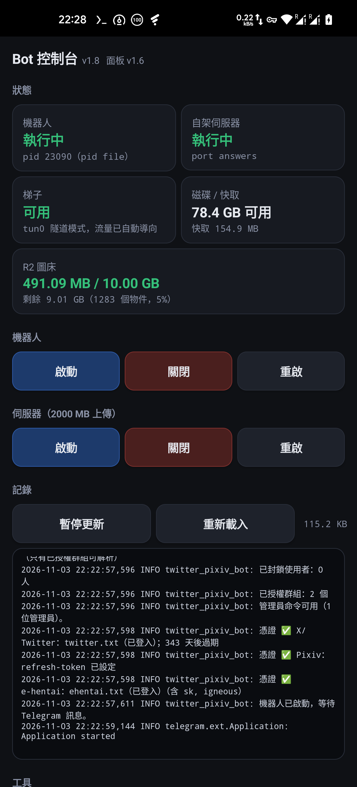

# 安裝與設定（Android）

[回到 README](../README.md)

開發環境為已 root 的 OnePlus 8 Pro（Pixel Experience 13、AOSP 13、aarch64）；程式不綁定特定手機，其他裝置可先執行探測腳本確認環境。

- [快速開始](#快速開始)
- [手機 App](#手機-app)
- [控制面板](#控制面板)
- [設定參考](#設定參考)
- [代理與網路](#代理與網路)
- [2000 MB 上傳上限](#2000-mb-上傳上限)

## 快速開始

### 需求

- Android 手機（arm64），**已 root** 才能用 2000 MB 上傳上限；不 root 也能跑，上限 50 MB
- Termux（[release 裡附 0.118.3](https://github.com/YuNaiAFK/twitter_pixiv_tg_bot_android/releases/latest)）
- 一個梯子 —— 開發時用 FlClash 的 **TUN 模式**
- Telegram 的 `api_id` / `api_hash`（<https://my.telegram.org>）

### 安裝

```bash
pkg install git
git clone https://github.com/YuNaiAFK/twitter_pixiv_tg_bot_android.git ~/twitter_pixiv_tg_bot
cd ~/twitter_pixiv_tg_bot
bash scripts/setup-termux.sh
```

這會裝好 Python 與相依套件、從範例建立 `.env`，然後**在 Debian chroot 裡建置自架的 Bot API 伺服器**。
建置是最慢的部分 —— **手機上 20 到 60 分鐘**，而且會編譯 TDLib，**請插著電源**。

不需要 2000 MB 上限的話：

```bash
bash scripts/setup-termux.sh --no-server
```

### 設定

編輯專案根目錄的 `.env`（完整清單見[設定參考](setup.md#設定參考)）：

```
BOT_TOKEN=<向 @BotFather 取得>
ADMIN_USER_IDS=<你的數字 id，在 bot 裡用 /id 取得>
```

要 2000 MB 上限再加上：

```
TELEGRAM_API_ID=<my.telegram.org>
TELEGRAM_API_HASH=<my.telegram.org>
TELEGRAM_API_BASE=http://127.0.0.1:8081
TELEGRAM_LOCAL=1
```

把登入憑證放進 `cookies/` —— `twitter.txt` 與 `ehentai.txt`，格式為 **Netscape cookie**。

> **刻意不使用 `gallery-dl --cookies-from-browser`。** Android 核心預設封鎖 `ptrace`，
> 讀取瀏覽器的 cookie 資料庫根本不可能運作。純 cookie 檔案是唯一可靠的方式。

Pixiv 用 refresh token，跑一次即可：

```bash
python bot/pixiv_login.py
```

### 執行

```bash
bash scripts/run-bot.sh                 # 前景，Ctrl-C 停止
bash scripts/run-bot.sh --background    # 關掉工作階段也不會停
bash scripts/run-bot.sh --status
bash scripts/run-bot.sh --stop

bash scripts/run-server.sh start|stop|restart|status|logs
```

**開機自動啟動：**

```bash
mkdir -p ~/.termux/boot
cp scripts/boot-services.sh ~/.termux/boot/10-bot.sh
chmod +x ~/.termux/boot/10-bot.sh
```

Termux:Boot 安裝後必須開啟一次，而且 **Termux 與梯子 App 都必須免除電池最佳化**，
否則 Android 會把它們殺掉。

## 手機 App

一個原生 App（`app/`），提供與控制面板相同的動作，**正常情況下 Termux 裡一個字都不用打。**



### 安裝 APK

需要的東西都附在[最新的 release](https://github.com/YuNaiAFK/twitter_pixiv_tg_bot_android/releases/latest)：

| 檔案 | 大小 | 是什麼 |
| --- | --- | --- |
| `bot-panel.apk` | 48.8 KB | 控制 App |
| `termux.apk` | 108.6 MB | Termux 本體（0.118.3，F-Droid 版）|
| `termux-api.apk` | 3.8 MB | 提供 `termux-wake-lock` |
| `termux-boot.apk` | 25.4 KB | 開機時啟動服務 |

```bash
adb install -r bot-panel.apk
adb install -r termux.apk
adb install -r termux-api.apk
adb install -r termux-boot.apk
```

**Termux 本體是 108.6 MB**，超過 GitHub 對單一檔案 100 MB 的上限，所以它放在 release 裡而不是
`apk/` 裡。**每個 release 都保留該版本的 `bot-panel.apk`**，新版本出問題時還是能取得舊的建置。

安裝程式做不到的兩件事，**兩件都必須完成**，App 才能啟動任何東西：

```bash
# 1. 讓 App 有權限送 intent 給 Termux
adb shell pm grant com.yunai.botpanel com.termux.permission.RUN_COMMAND

# 2. 讓 Termux 接受外部應用程式的 intent（然後 Termux 必須重新啟動）
bash ~/twitter_pixiv_tg_bot/scripts/enable-external-apps.sh
```

### 一鍵啟動

按下 **一鍵啟動服務** 會送出一個 `com.termux.RUN_COMMAND` intent，讓 Termux 執行
`scripts/start-all.sh` —— 與開機腳本用的是同一支。App 接著持續輪詢，直到面板回應、
卡片自己消失，**所以它也會偵測到你手動執行的指令**。

```bash
bash ~/twitter_pixiv_tg_bot/scripts/start-all.sh            # 全部，照順序
bash ~/twitter_pixiv_tg_bot/scripts/start-all.sh --status   # 只回報
bash ~/twitter_pixiv_tg_bot/scripts/start-all.sh --restart  # 先停，再起
```

### 全部關閉

**電源 → 全部關閉（含面板）** 會先停機器人、再停伺服器、最後停面板自己。

它被放在獨立的一區、遠離其他工具，因為那個畫面上的其他東西都能從那個畫面復原 ——
**而這一個結束了 App 自己的用處**，因為面板是最後消失的東西。

> **為什麼面板會先回應才死掉：** 請求是透過 HTTP 進來的，而面板本身就是被停止的東西之一。
> 在還處理著請求的時候把它殺掉，會在回應寫出之前就關掉 socket，App 就會對一個成功的動作
> 回報失敗 —— 那是最糟的一種回饋，因為它會誘使使用者再按一次。
>
> 所以工作被交給一個**分離**的行程（`start_new_session=True`），它等兩秒，而處理函式立刻回傳。
> 實測：回應在 13 毫秒內送達、讀到的時候伺服器已經消失、面板自己則在兩秒後結束。

**要回來不需要打任何字** —— 靠的就是「一鍵啟動服務」那張卡片，它**不需要面板活著**。

### 不用 Gradle 建置

Gradle 加上 Android Gradle Plugin 大約要下載 500 MB，第一次建置要好幾分鐘解析依賴。
這個 App 只有一個 activity、沒有任何函式庫依賴，所以 `build.ps1` 直接驅動 AGP 底下的工具鏈：
`aapt2`、`javac`、`d8`、`zipalign`、`apksigner`。**APK 只有 48.8 KB。**

```powershell
powershell -File app/build.ps1              # 建置
powershell -File app/build.ps1 -Install     # 也會推到裝置
powershell -File app/build.ps1 -Clean -Install
```

需要 541 MB 的 SDK：

```bash
sdkmanager "platform-tools" "platforms;android-34" "build-tools;34.0.0"
```

## 控制面板

一個本機網頁，用來啟動、停止、重啟機器人與伺服器，查看記錄、清除快取、編輯 `.env`。

```bash
bash control/run-panel.sh start      # 然後開啟 http://127.0.0.1:8090/
bash control/run-panel.sh status
bash control/run-panel.sh stop
```

在 Chrome 裡用**選單 → 加到主畫面**就會變成類應用程式圖示：manifest 設定了
`display: standalone`，所以它會全螢幕開啟、沒有網址列，而且因為所有東西都從手機內部提供，
**它可以離線運作**。

> **App 是透過面板跟 Termux 溝通的。** 啟動機器人意味著要在 Termux 裡跑 `run-bot.sh`，
> 而直接讀 Termux 的記錄不可能 —— `/data/data/com.termux/files/home` 對其他套件不可讀。
> 所以**面板沒在跑的時候，App 什麼都不能做**，它會顯示一個橫幅、寫出啟動用的指令，
> 而不是一個看起來壞掉的空白畫面。

**每一個按鈕都是去呼叫 `run-bot.sh` 或 `run-server.sh`。** 面板不重新實作啟動機器人，
所以它不可能跟那些腳本的行為脫節 —— 而且面板能做的事，在面板沒跑的時候用命令列一樣能做完。

**只綁定 `127.0.0.1`。** 面板可以讀寫 `.env`（裡面有 bot token），也可以啟動與停止機器人 ——
在沒有密碼的情況下從區網可達，那就等於一個遠端 shell。要對外開放必須明講：

```bash
PANEL_HOST=0.0.0.0 bash control/run-panel.sh start     # 會印出 token，每個請求都必須提供
```

**面板不在開機腳本裡。** 沒有理由地讓一個 HTTP 服務一直跑著，是一種不值得養成的習慣。

## 設定參考

所有設定都在專案根目錄的 `.env`。`.env` **先讀專案根目錄**，再讀 `bot/`，
所以只要編輯最上層那一個檔案。

### 必要

| 鍵 | 說明 |
| --- | --- |
| `BOT_TOKEN` | 向 [@BotFather](https://t.me/BotFather) 取得 |
| `ADMIN_USER_IDS` | 數字 id，用逗號分隔。在 bot 裡打 `/id` 取得 |
| `BLOCKED_USER_IDS` | 封鎖名單（私訊黑名單模式）|

### 上傳

| 鍵 | 預設 | 說明 |
| --- | --- | --- |
| `MAX_UPLOAD_MB` | `45` | 單檔上限。不用伺服器時保持在 50 以下 |
| `MAX_FILES` | `20` | 單次解析最多幾個檔案 |
| `MAX_DOWNLOAD_SECONDS` | `180` | 下載逾時 |
| `MAX_CONCURRENT_DOWNLOADS` | `2` | 同時幾個解析 |
| `USER_COOLDOWN_SECONDS` | `10` | 每人兩次指令之間的最短間隔 |

### 快取

| 鍵 | 預設 | 說明 |
| --- | --- | --- |
| `CACHE_FILE` | `parse_cache.json` | 索引 |
| `CACHE_DIR` | `.cache` | 檔案（只有 Twitter／Pixiv 會用到）|
| `CACHE_STALE_SECONDS` | `1209600`（14 天）| 條目過期 |
| `CACHE_MAX_ENTRIES` | `300` | 條目上限 |
| `GALLERY_META_TTL_SECONDS` | **`0`** | **0 = 每次都重讀 tag／標題／評分** |
| `GALLERY_URL_TTL_SECONDS` | `7200`（2 小時）| 掃描到的圖片網址多久重用一次 |
| `GALLERY_CACHE` | `1` | 關掉會失去 Telegraph 頁面複用 |
| `ARCHIVE_CACHE` | `1` | 官方 ZIP 快取 |
| `ARCHIVE_CACHE_MAX_BYTES` | `8589934592`（8 GB）| 歸檔快取上限 |

### e-hentai

| 鍵 | 預設 | 說明 |
| --- | --- | --- |
| `EHENTAI_COOKIES` | `cookies/ehentai.txt` | Netscape 格式 |
| `TELEGRAPH_ALLOW_ADULT` | `1` | 成人畫廊要不要建立頁面 |
| `TELEGRAPH_AUTHOR` | `e-hentai 解析` | 頁面上顯示的作者 |
| `EHENTAI_VIEWER_WORKERS` | `6` | 掃描頁面時的並行數 |
| `EHENTAI_DOWNLOAD_WORKERS` | `6` | 下載頁面時的並行數 |
| `ARCHIVE_DEADLINE_SECONDS` | `300` | 官方歸檔的整體時限 |

### 圖床（選用）

五個值**必須全部填寫**，否則 R2 不啟用。詳見 [R2 圖床](maintenance.md#r2-圖床與免費額度)。

```bash
R2_ACCOUNT_ID=
R2_ACCESS_KEY=
R2_SECRET_KEY=
R2_BUCKET=
R2_PUBLIC_BASE=          # 例如 https://img.example.com
R2_FREE_BYTES=10000000000
R2_LIMIT_PERCENT=95
```

### 網路

| 鍵 | 預設 | 說明 |
| --- | --- | --- |
| `BOT_PROXY` | （未設）| **TUN 模式下不要設**，見[代理與網路](setup.md#代理與網路) |
| `TELEGRAM_API_BASE` | （未設）| 自架伺服器：`http://127.0.0.1:8081` |
| `TELEGRAM_LOCAL` | `0` | `1` = 把路徑交給 Telegram，連上傳時間都省掉 |
| `STARTUP_WAIT_SECONDS` | `900` | 開機時最多等網路多久 |

### 行為

| 鍵 | 預設 | 說明 |
| --- | --- | --- |
| `REPLY_UNSUPPORTED_LINKS` | `0` | `0` = 不支援的連結完全靜默 |
| `ATTACH_SOURCE_LINK` | `1` | 附上原始連結 |
| `DELETE_STATUS_MESSAGE` | `1` | 完成後刪除機器人送出的「正在解析……」提示；使用者原始訊息一律保留 |
| `AUTH_GROUP_LOCKED` | `0` | `1` = 只允許授權過的群組 |

## 代理與網路

### TUN 模式：不要設代理

如果你的梯子跑在 **VPN／TUN 模式**（FlClash、v2rayNG 都是），**讓 `BOT_PROXY` 保持未設**。
流量已經被重新導向，再設代理只會讓每個請求失敗在一個關閉的埠上。

> **這個錯誤看起來不像設定問題。** 實測：`tun0` 正常、直連 `api.telegram.org` 回 302、
> `e-hentai.org` 回 200 —— 而每一個下載都失敗在
> `ProxyError: Failed to establish a new connection: [Errno 111] Connection refused`，
> 因為 `BOT_PROXY` 還指著切換模式前那個代理埠。
>
> **一個設定好但死掉的代理，比沒有代理更糟** —— 沒有代理會成功，關閉的埠讓每個請求失敗。

`ehentai.proxy_url()` 現在會**先探測 loopback 代理**，埠沒開就回退成直連，
所以切換模式不會再弄壞一個能用的網路。遠端代理不探測 —— 那是刻意的選擇，
短暫變慢不等於不存在。

### 代理模式：要用 HTTP 格式

只有在梯子確實開了一個**監聽中的代理埠**時才需要設定：

```
BOT_PROXY=http://127.0.0.1:7890
```

**格式很重要，因為 `apt` 與 `pip` 都不能用 SOCKS**，而兩者回報錯誤的方式都會把責任推給別的東西：

```
$ apt-get update
Unsupported proxy configured: socks5://127.0.0.1:10808
E: The repository 'https://packages-cf.termux.dev/apt/termux-main stable Release'
   does not have a Release file.
```

那段訊息點名的是**儲存庫**，所以讀起來像是鏡像站壞了。但實際上**每一個 Termux 鏡像都在正常提供它的
Release 檔** —— 從同一網段的電腦驗證過，五個全部回 `200`、內容都是 13134 位元組 —— 而 `apt` 對每一個都失敗。
**那行 SOCKS 才是唯一的線索，而它在錯誤訊息的上面。**

| 檔案 | 格式 | 原因 |
| --- | --- | --- |
| `~/.proxy-url` | **HTTP** | `apt` 與 `pip` 需要，也是 `~/.bashrc` 讀的 |
| `apt.conf.d/95proxy` | **HTTP** | apt 讀這個檔案，**優先於**環境變數 |
| shell 裡的 `http_proxy` | HTTP | 讓每個子行程都拿到可用的格式 |

**如果 apt 又說找不到 Release 檔**，先檢查代理再檢查鏡像站：

```bash
cat $PREFIX/etc/apt/apt.conf.d/95proxy
cat ~/.proxy-url
```

兩者都必須是 `http://`。**只在終端機裡修正會被下一次執行覆蓋掉；那個檔案才是關鍵。**

## 2000 MB 上傳上限

Telegram 公開 API 的單次上傳上限是 **50 MB**。自架 Bot API 伺服器可以提高到 **2000 MB**，
而 `TELEGRAM_LOCAL=1` 讓機器人把**路徑**交給 Telegram 而不是上傳位元組 —— 連上傳時間都省掉了。

`MAX_UPLOAD_MB=45` 是預設值，正是為了讓機器人在兩種情況下都能運作：沒有伺服器時，
檔案維持在 50 MB 公開上限內，不會有任何東西失敗。有伺服器時再把它調高。

**所以這個上限完全是選用的** —— 不建置伺服器，機器人照樣運作。

### 需要什麼

透過 `proot-distro` 的 Debian chroot，加上從原始碼編譯的 `telegram-bot-api`。
TDLib 佔了大半：在 8 核心手機上用 `-j2` 大約 **40 分鐘**，另外 rootfs 與建置目錄約需 1.1 GB。
結果是一個 45 MB 的執行檔。

### 這個執行檔不能直接跑

```
$ .../containers/botapi/rootfs/usr/local/bin/telegram-bot-api
cannot execute: required file not found
```

它的解譯器是 `/lib/ld-linux-aarch64.so.1`，那是 Debian 的 glibc 載入器。Android 用的是
`/system/bin/linker64`。**訊息從來沒提到載入器，所以讀起來像是檔案不見了。** 它必須透過：

```
proot-distro login botapi -- /usr/local/bin/telegram-bot-api ...
```

`run-server.sh` 就是做這件事。它也會嘗試兩種 rootfs 佈局，因為 **proot-distro 5.x 把它搬走了** ——
從 `installed-rootfs/<name>` 移到 `containers/<name>/rootfs`。只檢查舊路徑的話，
會對一個明明存在的執行檔回報「binary missing」。

### loopback 是共用的

從 Termux 應用程式實測：在 chroot 裡啟動一個監聽 `0.0.0.0:8099` 的服務，Termux 可以連上它，
所以機器人從容器外面連 `127.0.0.1:8081` 不需要任何轉送。

> ### ⚠️ 不要透過 `su` 測試這件事
>
> 用 `su 10209` 啟動的行程會落在 SELinux 網域 `u:r:magisk:s0`，在那裡建立 socket 會失敗，
> 回報 `PermissionError` / `socket: Permission denied`。**每一個用這種方式跑的網路測試都會回報網路壞了。**
>
> 三次獨立的調查分別得出「VPN 被殺了」、「VPN 從 chroot 連不到」、「chroot 被網路隔離」的結論，
> 全都是因為這個原因，而且**三次都錯了**。網路檢查必須從 Termux 應用程式執行。

### 建置時的兩個陷阱

**`proot-distro` 不需要 root** —— 它在使用者空間行程裡用 ptrace 實作 chroot 與 mount。
`su` 在這裡反而有害，因為它會把行程移到一個讀不到 Termux 自己目錄的網域。

**`PKG_CONFIG_PATH` 必須清掉。** 留著的話，pkg-config 會回答 **Termux 的** OpenSSL，
然後 CMake 會記下 `-isystem /data/data/com.termux/files/usr/include`，建置就會用 Debian 的 gcc
去編譯 Android/bionic 的標頭檔 —— 結果在 `sqlite3.c` 裡失敗，錯誤訊息是 `memccpy` 與 `strcasecmp`，
**跟 sqlite 一點關係都沒有的檔案。**

## 7z 與 RAR 解壓元件

在 Termux 執行 `pkg install libarchive`，再執行 `python -m pip install "libarchive-c>=5.3,<6"`。安裝與引導腳本已包含這兩項依賴。

以串流逐張讀取圖片，不會直接還原壓縮檔內路徑；沿用原有張數、單張與解壓大小上限。加密、不完整分卷或無法解碼的壓縮檔會在原操作訊息顯示錯誤，請先提供完整且未加密的單一檔案。
